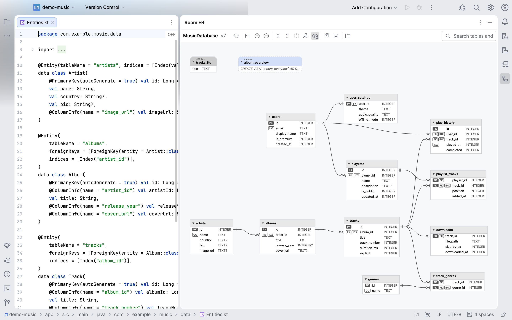
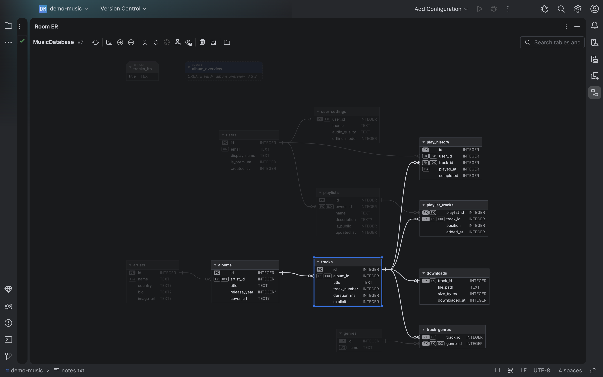
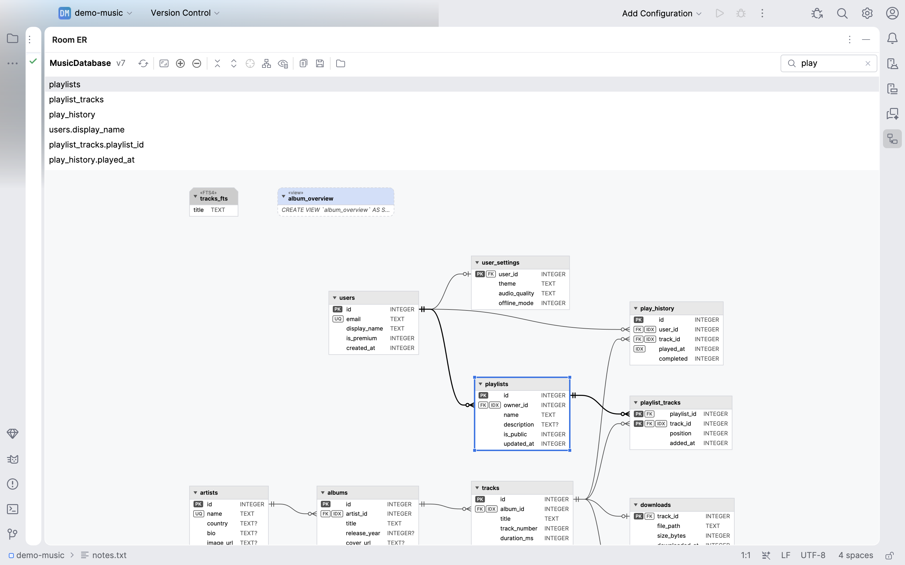
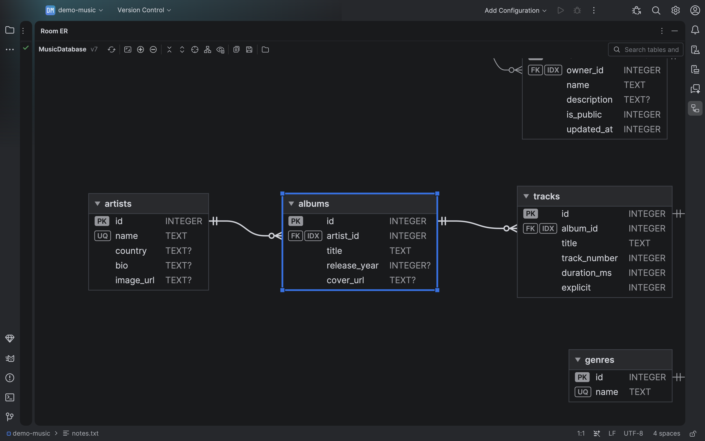
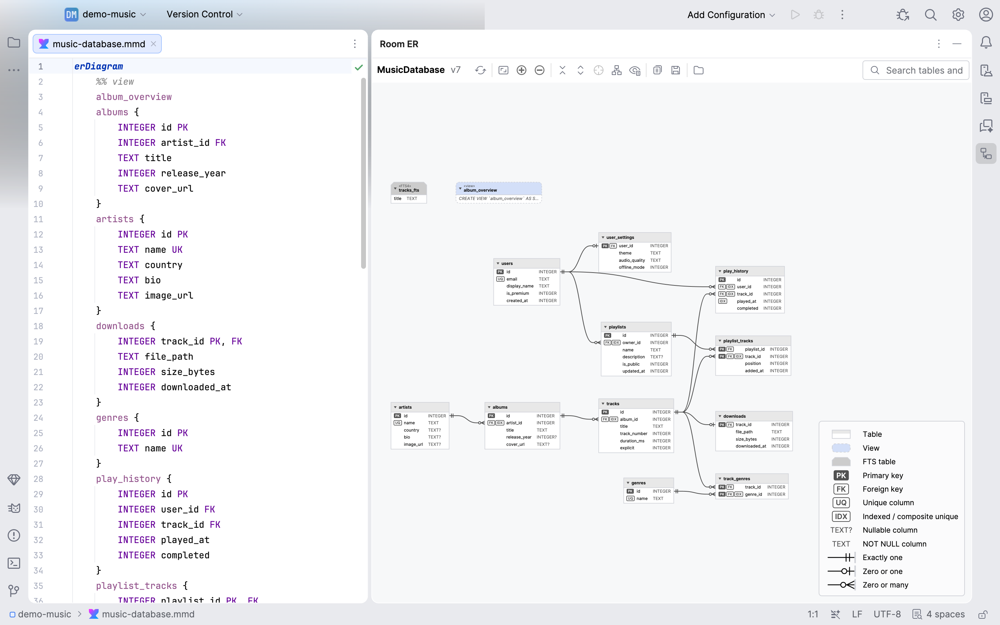

# RoomEr – Room ER Diagrams

An Android Studio plugin that reads the schema files exported by [Room](https://developer.android.com/training/data-storage/room)
and shows them as an interactive entity-relationship diagram in the **Room ER** tool window.



## Features

### The whole database at a glance

Every table, view and FTS table with its columns and types, laid out automatically. Foreign keys are drawn in
crow's-foot notation with their cardinality worked out from the schema: one-to-one, one-to-many and the junction
tables of many-to-many relationships. Drag tables where you want them; RoomEr remembers the positions per database
and reloads the diagram by itself after every build.

### Focus on one table

Select a table and turn on **Focus mode** to see only it and the tables it is linked to by foreign keys; everything
else fades into the background. RoomEr follows the IDE theme: light, dark and high contrast.



### Find any table or column

Type in the search box (or press `/`) to find tables and columns by name. Pick a result to jump to it on the
diagram; `Enter` on a selected table opens its `@Entity` class in the editor (Kotlin or Java).



### Every key and index in view

Badges mark primary keys (`PK`), foreign keys (`FK`), unique columns (`UQ`) and indexed columns (`IDX`). Nullable
types end in `?`. The relationship ends show exactly one, zero or one, or many.



### Export to Mermaid

**Copy as Mermaid** or **Save as .mmd** turns the schema into a Mermaid `erDiagram` for READMEs, wikis and
pull requests: GitHub, GitLab and Notion render it directly.



### Also

- Several databases per project, with a switcher in the tool window
- Collapse tables to their names, reset the layout, show or hide the legend
- Read-only and offline: no network access, no telemetry

## Installation

- **JetBrains Marketplace** (coming soon): **Settings | Plugins | Marketplace**, search for "RoomEr", install.
- **From disk:** download `RoomEr-<version>.zip` from [Releases](https://github.com/oguzhanaslann/RoomEr/releases),
  then **Settings | Plugins | ⚙ | Install Plugin from Disk…** and pick the zip without unzipping it.

Requires Android Studio 2026.1 (Quail) or newer.

## Setup: export your Room schema

RoomEr reads the JSON that Room writes at build time, so schema export must be on.

1. Keep `exportSchema` enabled (it is the default) on your database:

   ```kotlin
   @Database(entities = [User::class], version = 3, exportSchema = true)
   abstract class AppDatabase : RoomDatabase()
   ```

2. Tell Room where to write the files, in the module's `build.gradle.kts`:

   ```kotlin
   plugins {
       id("androidx.room")
   }

   room {
       schemaDirectory("$projectDir/schemas")
   }
   ```

   or, without the Room Gradle plugin:

   ```kotlin
   ksp {
       arg("room.schemaLocation", "$projectDir/schemas")
   }
   ```

3. Build the project. Room writes `schemas/<fully.qualified.DatabaseClass>/<version>.json`.

4. Open **View | Tool Windows | Room ER**.

RoomEr scans the project for `**/schemas/<databaseName>/<n>.json` and shows the highest version of each
database. If your files live somewhere unusual, use **Choose schema folder…** in the tool window.

## Using the diagram

| Action | Mouse | Keyboard |
|---|---|---|
| Pan | drag the background, or middle-button drag | |
| Zoom | mouse wheel | `+` / `-`, `0` = fit to window |
| Select | click a table | arrow keys move between connected tables |
| Go to source | double-click, or context menu | `Enter` |
| Search | search box | `/` or `Ctrl/Cmd+F` |
| Clear search / leave focus mode | | `Esc` |
| Move a table | drag it | |

Relationship ends: the parent end is *exactly one* when every foreign-key column is `NOT NULL`, otherwise
*zero or one*. The child end is *one* when the foreign-key columns are the child's primary key or are covered
by a unique index, otherwise *many*.

## Compatibility

- Android Studio: the latest two stable releases.
- Room schema JSON `formatVersion` 1. Other versions are reported as unsupported instead of being guessed at.

## Building

Requires JDK 21 or newer.

```sh
./gradlew buildPlugin      # plugin zip in build/distributions
./gradlew check            # all tests, plus the build-enforced rules below
./gradlew runIde           # sandbox IDE with the plugin
./gradlew verifyPlugin     # JetBrains plugin verifier against the IDEs in `pluginVerifierIdes`
./gradlew :render:runDemo  # the diagram canvas in a plain window, no IDE needed
```

`check` also runs two rules from the acceptance criteria:

- `checkUiFreeModules`: `model`, `parser`, `layout` and `export` must not import Swing, AWT or IntelliJ classes.
- `checkNoNetworkAccess`: no HTTP client or telemetry library is bundled, and the plugin's code makes no network calls.

By default the build downloads the Android Studio release named in `gradle.properties`. To build against
an installed IDE instead, create `local.properties` with:

```properties
platformLocalPath=/Applications/Android Studio.app
```

### Modules

| Module | Contents | Depends on |
|---|---|---|
| `model` | Immutable schema model, cardinality inference, search | – |
| `parser` | Room JSON → model, typed errors | `model` |
| `layout` | `LayoutEngine` interface, ELK implementation | – |
| `export` | Mermaid generator | `model` |
| `render` | Swing/Java2D canvas | `model`, `layout` |
| root | Discovery, tool window, navigation, persisted state | all of the above, IntelliJ Platform |

Only the root project depends on the IntelliJ Platform. The logic modules are plain Kotlin/JVM modules, so
they cannot reference Swing-in-IDE or platform UI classes.

## Screenshots

`./gradlew runIdeScreenshots` opens the demo project in `samples/demo-music` in a sandbox Android Studio, captures the
Marketplace screenshots (2880×1800) into `build/screenshots/` and closes the IDE. The driver is a dev-only plugin in
`tools/screenshots` that never ships with RoomEr. Copy the results to `docs/screenshots/` when they change.

## Releasing

1. Set `version` in `gradle.properties` and move the `[Unreleased]` notes in `CHANGELOG.md` under a
   `## [x.y.z] - date` heading. That section becomes the change notes shown in Android Studio and on the Marketplace.
2. Commit, then tag and push: `git tag vx.y.z && git push origin main vx.y.z`.
3. The `Release` workflow (`.github/workflows/release.yml`) tests and verifies the plugin, publishes it to
   JetBrains Marketplace (when the `PUBLISH_TOKEN` secret is set) and attaches the zip to a GitHub release.
   A version like `0.1.0-eap.1` goes to the Marketplace `eap` channel.

Signing is optional: set the `CERTIFICATE_CHAIN`, `PRIVATE_KEY` and `PRIVATE_KEY_PASSWORD` secrets to sign the
published zip. The very first Marketplace upload has to be done by hand on plugins.jetbrains.com.

## Project documentation

| File | Contents |
|---|---|
| `docs/01-discovery-notes.md` | Decisions and their rationale, non-goals, risks |
| `docs/02-spec.md` | Functional and non-functional requirements |
| `docs/03-user-stories.md`, `docs/04-acceptance-criteria.md` | User stories and acceptance criteria |
| `docs/05-implementation-status.md` | Current status, toolchain, remaining work |
| `docs/06-learnings.md` | Lessons learned that are not obvious from the code |
| `docs/notes/*.md` | Per-module handover notes |

## Licence

Apache-2.0, see [LICENSE](LICENSE). Third-party components are listed in [NOTICE](NOTICE).
